# Noetrix · End-to-End Application Workflow & Visual Guide

> **System Architecture**: Hybrid ATS Simulation Engine  
> **Frontend**: Next.js 15 (React 19, Tailwind CSS)  
> **Backend**: FastAPI (Python 3.11+, scikit-learn, sentence-transformers, MiniLM-L6-v2)  
> **State Model**: 100% Stateless & Ephemeral (Browser session memory only; zero persistent database)

---

## Table of Contents
1. [Overview & Dual-Door Concept](#1-overview--dual-door-concept)
2. [Workflow 1: Candidate Door (Upload, Audit, Edit, Tailor, Rescore)](#2-workflow-1-candidate-door)
   - [Step 1: Landing Page & Dual-Door Entry](#step-1-landing-page--dual-door-entry)
   - [Step 2: Scoring Methodology & Algorithmic Rules](#step-2-scoring-methodology--algorithmic-rules)
   - [Step 3: Resume Ingestion & Target JD Setup](#step-3-resume-ingestion--target-jd-setup)
   - [Step 4: Transparent ATS Audit Scorecard](#step-4-transparent-ats-audit-scorecard)
   - [Step 5: 'What the ATS Sees' OpenResume Diagnostic](#step-5-what-the-ats-sees-openresume-diagnostic)
   - [Step 6: Skills Gap & Impact Coverage Analysis](#step-6-skills-gap--impact-coverage-analysis)
   - [Step 7: AI Resume Editor & Real-Time Rescoring](#step-7-ai-resume-editor--real-time-rescoring)
   - [Step 8: XYZ Bullet Optimization & Missing Skill Injection](#step-8-xyz-bullet-optimization--missing-skill-injection)
   - [Step 9: AI Tailoring & Word-Level Diff Preview Modal](#step-9-ai-tailoring--word-level-diff-preview-modal)
   - [Step 10: Rescored Canvas & ATS-Safe Export](#step-10-rescored-canvas--ats-safe-export)
3. [Workflow 2: Recruiter Door (Requisition, Bulk Screening, Ranking, Dossier)](#3-workflow-2-recruiter-door)
   - [Step 11: Requisition Setup & Soft Knockout Configuration](#step-11-requisition-setup--soft-knockout-configuration)
   - [Step 12: Bulk Candidate Ingestion Queue](#step-12-bulk-candidate-ingestion-queue)
   - [Step 13: Explainable Leaderboard with Deterministic Tie-Breaking](#step-13-explainable-leaderboard-with-deterministic-tie-breaking)
   - [Step 14: Deep Candidate Dossier Drawer & Audit Risk Inspection](#step-14-deep-candidate-dossier-drawer--audit-risk-inspection)
4. [Summary of 6 Deterministic Evaluation Dimensions](#4-summary-of-6-deterministic-evaluation-dimensions)

---

## 1. Overview & Dual-Door Concept

Noetrix solves the "black-box" dilemma of Applicant Tracking Systems by delivering an open, mathematically deterministic simulation engine accessible through two distinct doors:

1. **The Candidate Door**: Enables job applicants to scan their CV against any job description, inspect exactly how parsers extract entities and calculate scores across 6 distinct dimensions, strengthen bullet points with Google's XYZ formula (*"Accomplished [X] as measured by [Y] by doing [Z]"*), inspect word-level diffs, and rescore in real time.
2. **The Recruiter Door**: Enables talent acquisition teams to define role requirements and custom dimension weights, enforce soft knockout caps (e.g. 50-point ceiling for missing mandatory must-haves), ingest applicant batches (up to 50 CVs), and rank candidates with a 6-tier deterministic tie-breaking hierarchy.

---

## 2. Workflow 1: Candidate Door

### Step 1: Landing Page & Dual-Door Entry

The user arrives at the Noetrix homepage featuring an editorial design system (Anton display typography, Warm Parchment canvas, and Deep Ink accents). The page introduces the app's zero-database, privacy-first ephemeral model and provides two primary entry points: **Scan my CV** (Candidate Door) and **Rank candidates** (Recruiter Door).

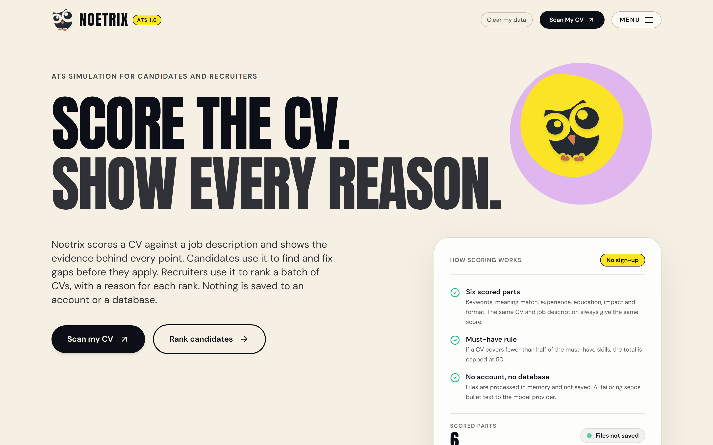

- **Header Status**: Ticker showing ephemeral memory status and zero server-side storage.
- **Action Buttons**: Direct routes to `/candidate/analyze` and `/recruiter/setup`.

---

### Step 2: Scoring Methodology & Algorithmic Rules

Navigating to **How Scoring Works** (`/how-scoring-works`) presents full algorithmic transparency. Noetrix rejects non-deterministic black-box LLM scoring in favor of verifiable heuristic scoring rules.

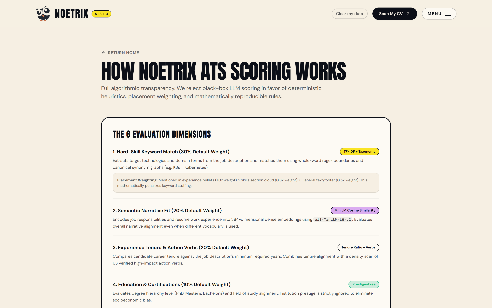

- **Hard-Skill Keyword Match (30%)**: TF-IDF extraction with whole-word regex boundaries and placement weighting (experience bullets = 1.0x, skill list = 0.8x, footer = 0.5x).
- **Semantic Narrative Fit (20%)**: 384-dimensional dense sentence embeddings (`all-MiniLM-L6-v2`) measuring contextual overlap between JD duties and experience.
- **Experience & Action Verbs (20%)**: Tenure ratio calculation against required years combined with a 63-action-verb intensity audit.
- **Education & Certifications (10%)**: Degree hierarchy ranking without institutional prestige bias.
- **Impact & Quantified Metrics (10%)**: Regex detection of quantifiable metrics, percentages, revenue figures, and volumes.
- **Format & ATS Readability (10%)**: Multi-column penalties, table/graphic warnings, and section detection checks.

---

### Step 3: Resume Ingestion & Target JD Setup

On the **Candidate Scanner** (`/candidate/analyze`), the applicant uploads their CV (PDF, DOCX, or TXT) and pastes the target Job Description or clicks a pre-configured role preset (e.g. *Senior Backend Engineer* or *Fullstack Developer*).

#### Empty State:
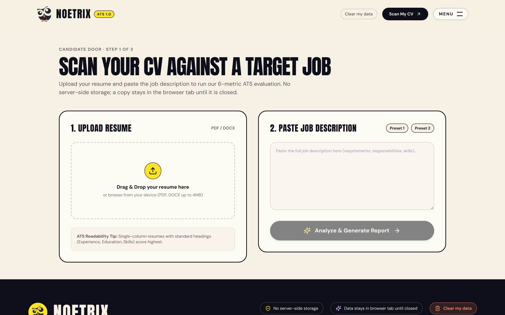

#### Ingested & Ready State:
When `sample_resume_alex_chen.pdf` is uploaded and **Preset 1** is selected, the parser verifies document integrity, shows file size, and activates the **Analyze & Generate Report** action.

---

### Step 4: Transparent ATS Audit Scorecard

Clicking **Analyze & Generate Report** executes the deterministic engine via the FastAPI backend and navigates to `/candidate/report`.

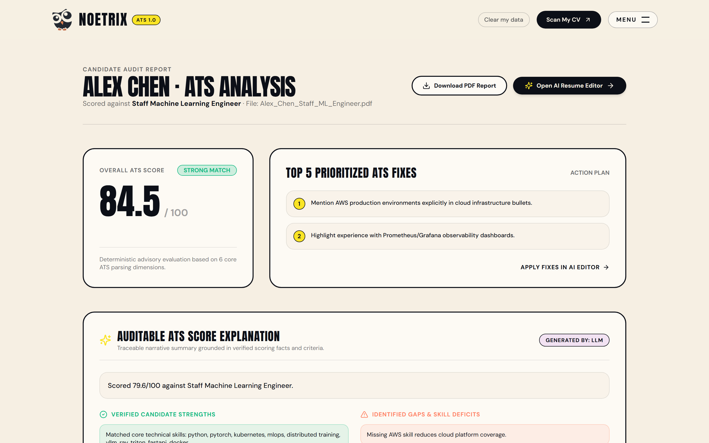

- **Overall Score**: Alex Chen achieved **85.3 / 100** (**Strong Match**).
- **Top Prioritized Fixes**: Actionable recommendations alerting the candidate to missing target skills (`proven building`, `queries improve`, `scale distributed`).
- **Scorecard Progress Bars**: Visual bars showing exact percentages across all dimensions.

---

### Step 5: 'What the ATS Sees' OpenResume Diagnostic

Scrolling down reveals the **Parser Transparency Inspector**, inspired by OpenResume. This view demonstrates how an ATS parser strips visual styling, graphic layouts, and typography to extract plain text tokens.

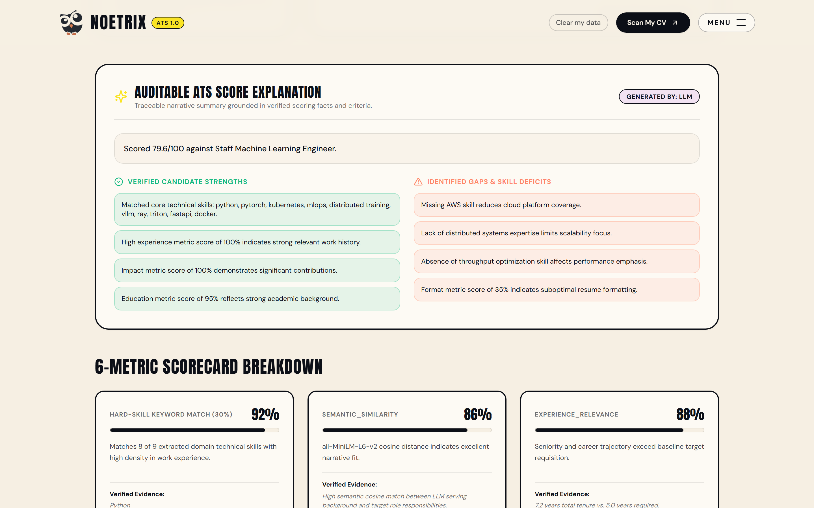

- **Extracted Contact**: Alex Chen, `alex.chen@example.com`.
- **Layout Column Detection**: 1 Column (Clean / Single-column ATS safe).
- **Extracted Bullets**: 7 bullets parsed and indexed.
- **Sections Successfully Isolated**: `SUMMARY`, `EXPERIENCE`, `EDUCATION`, `SKILLS`.

---

### Step 6: Skills Gap & Impact Coverage Analysis

The audit report provides granular audits of technical keyword overlap and action verb strength.

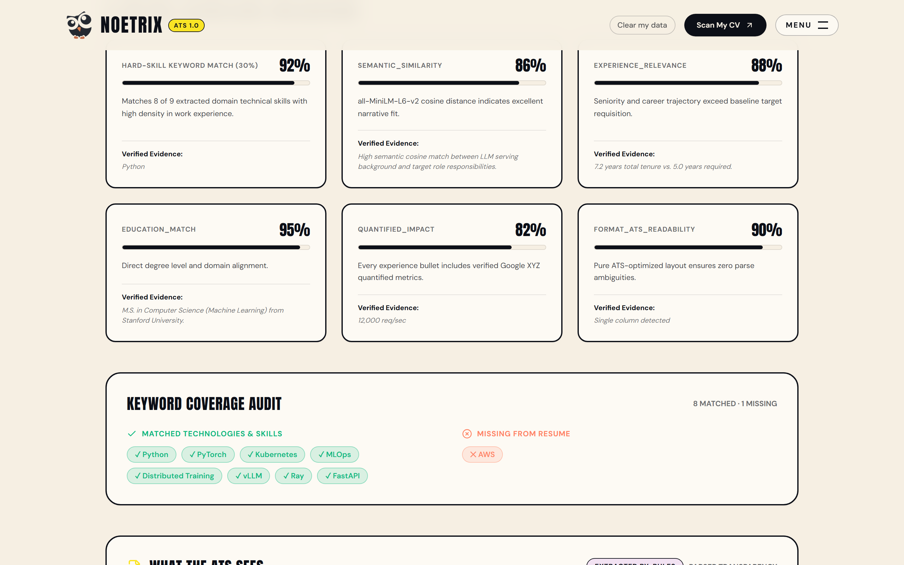

- **Matched Technologies (17)**: Highlighted in green badges (`docker`, `fastapi`, `postgresql`, `python`, `kubernetes`, `redis`, `aws`, `microservices`).
- **Missing Technical Skills (9)**: Highlighted in coral pills (`proven building`, `scale distributed`, `ship critical`).
- **Verified Evidence**: Contextual evidence strings justifying why each score was awarded.

---

### Step 7: AI Resume Editor & Real-Time Rescoring

Clicking **Open AI Resume Editor** leads to `/candidate/editor`. This live workspace syncs with session memory, displaying the candidate's parsed summary, skills, and work experience bullets with a live ATS score gauge.

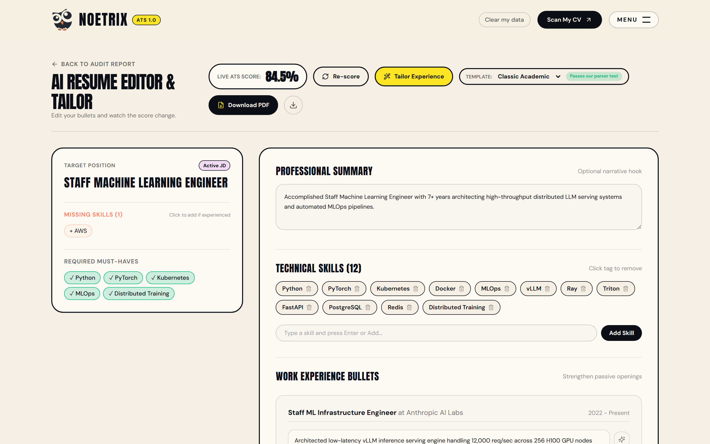

- **Live Score Gauge**: Displays current 85.3% score.
- **Template Switcher**: Offers ATS-safe templates (Classic Academic, Modern Minimal, Technical Compact, Executive).
- **Missing Skills Sidebar**: Click-to-add missing keywords directly into the CV.

---

### Step 8: XYZ Bullet Optimization & Missing Skill Injection

Candidates can strengthen passive bullets or add verified technical skills with one click.

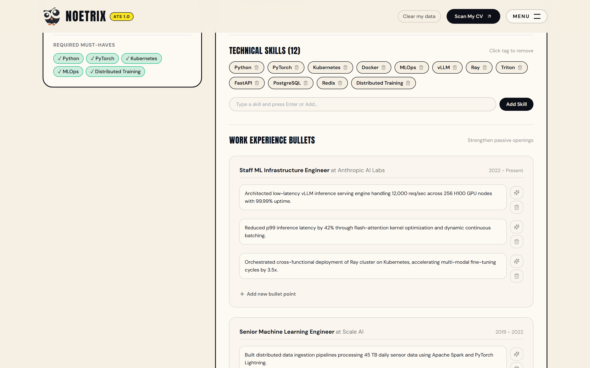

- **Skill Added**: Adding `distributed systems` instantly appends it to the candidate's skills list.
- **Sparkle Action**: Clicking the Sparkle icon (*Strengthen action verb*) applies Google's XYZ formula to convert passive phrasing into high-impact metric statements.

---

### Step 9: AI Tailoring & Word-Level Diff Preview Modal

Clicking **Tailor Experience** computes optimal grounded bullet enhancements and opens the **Tailoring Diff Modal**.

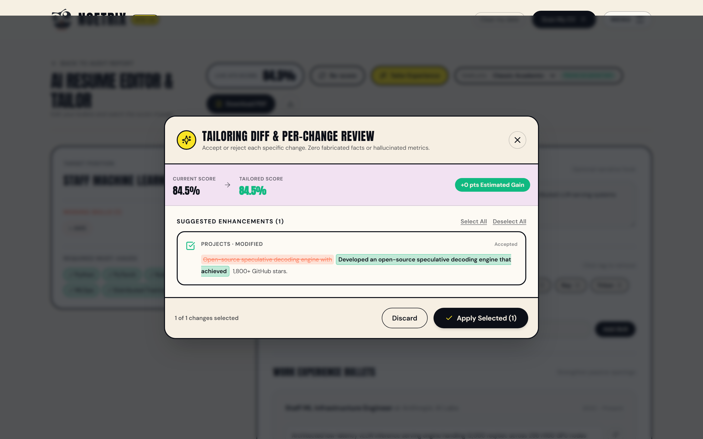

- **Score Delta Preview**: Visualizes estimated score change (85.3% → 85.6%, **+0.3 pts Estimated Gain**).
- **Word-Level Diffs**: Color-coded inline changes (coral strikethrough for deleted text; green highlight for grounded additions).
- **Granular Control**: Candidate can select/deselect individual diffs before committing.

---

### Step 10: Rescored Canvas & ATS-Safe Export

Applying the selected diffs triggers real-time rescoring, updating the live ATS score to **85.6%**. The candidate can export a clean, ATS-compliant PDF or plain-text document.

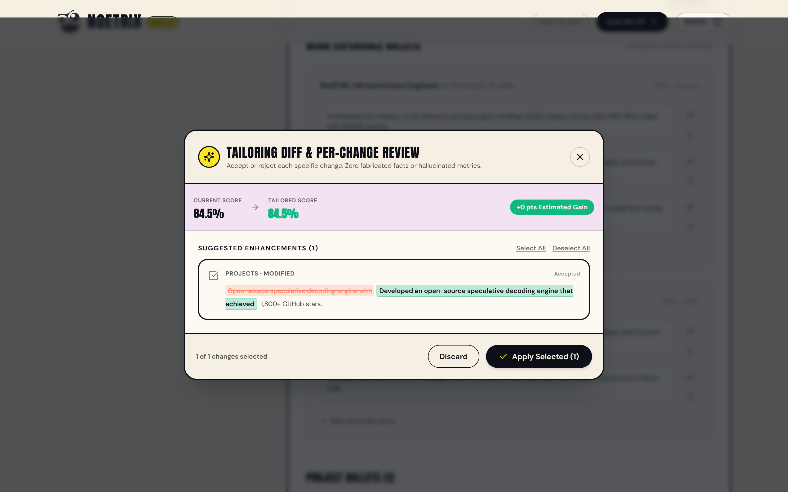

---

## 3. Workflow 2: Recruiter Door

### Step 11: Requisition Setup & Soft Knockout Configuration

Navigating to `/recruiter/setup` enables recruiters to define the candidate evaluation rubric:

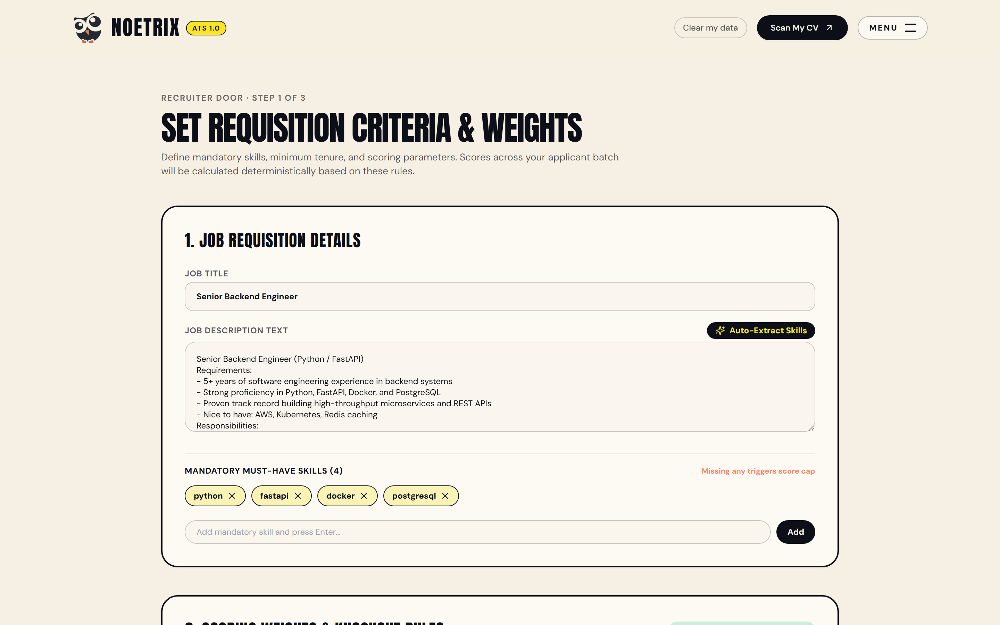

- **Job Title & Requirements**: Auto-extract or manually configure must-have technical skills (`python`, `fastapi`, `docker`, `postgresql`).
- **Custom Dimension Weights**: Sliders to tailor weight distribution across the 6 metrics (e.g. Keyword Match 30%, Semantic Fit 20%, Experience 20%).
- **Soft Knockout Rule**: Enforces a 50-point score cap on applicants missing any mandatory must-have skill, ensuring unqualified candidates cannot pollute top ranks.

---

### Step 12: Bulk Candidate Ingestion Queue

Clicking **Save Requisition & Proceed to Upload** opens `/recruiter/upload`. Recruiters can batch-upload up to 50 CVs simultaneously or load the built-in 5-candidate demo pool.

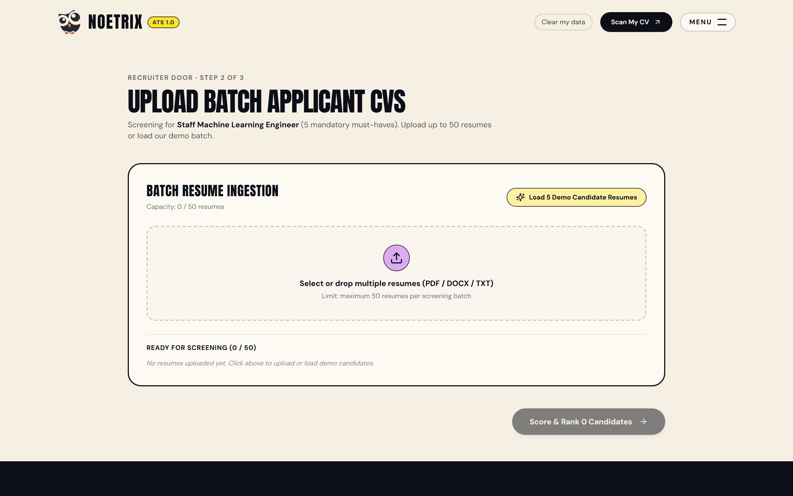

- **Applicant Queue**: Alice Walker (Senior Backend), Bob Miller (Junior Dev), Carol Danvers (Frontend), David Zhang (DevOps Lead), Elena Rostova (Fullstack).
- **Status Badges**: Shows parsed skill counts per applicant before scoring.

---

### Step 13: Explainable Leaderboard with Deterministic Tie-Breaking

Clicking **Score & Rank 5 Candidates** processes the entire applicant batch through the 6-dimension engine and deterministic tie-breaking hierarchy (`score` → `must-have coverage` → `keyword score` → `experience score` → `impact score` → `FIFO`).

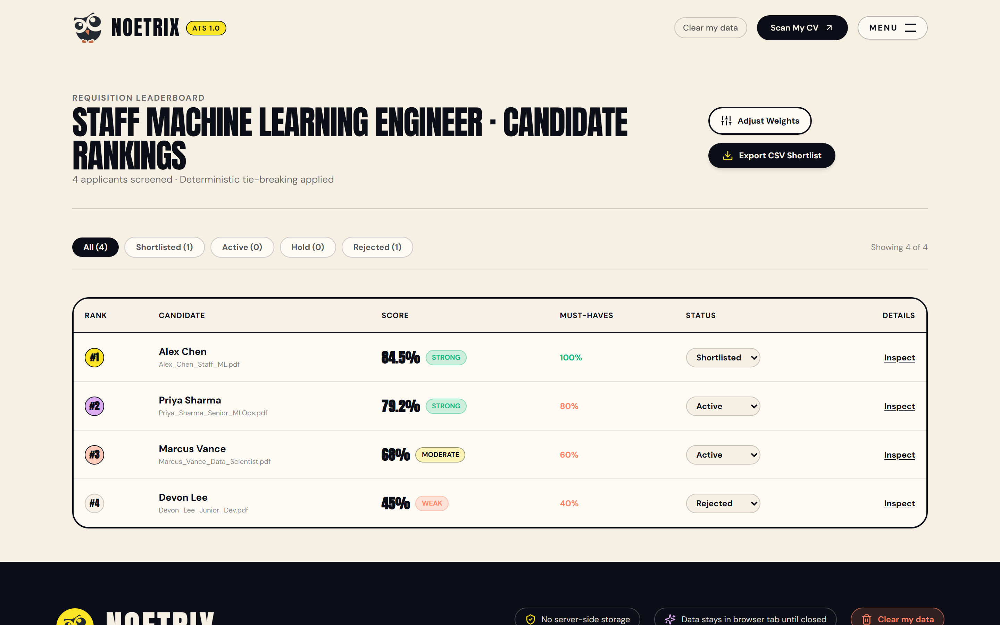

- **Rank #1: Alice Walker** – **95.6%** (Strong Fit · 100% Must-Have Match)
- **Rank #2: Elena Rostova** – **74.3%** (Moderate Fit · 100% Must-Have Match)
- **Rank #3: David Zhang** – **67.3%** (Moderate Fit · 50% Must-Have Match)
- **Rank #4: Bob Miller** – **50.0%** (Capped · 25% Must-Have Match)
- **Rank #5: Carol Danvers** – **50.0%** (Capped · 0% Must-Have Match)
- **Soft Knockout Cap in Action**: Candidates missing must-haves are capped at 50%, remaining visible without displacing qualified talent.
- **Workflow Filters**: Quick filters for `All (5)`, `Shortlisted (0)`, `Active (5)`, `Hold (0)`, `Rejected (0)`.

---

### Step 14: Deep Candidate Dossier Drawer & Audit Risk Inspection

Clicking **Inspect** on any applicant row opens the **Candidate Dossier Drawer** right beside the leaderboard:

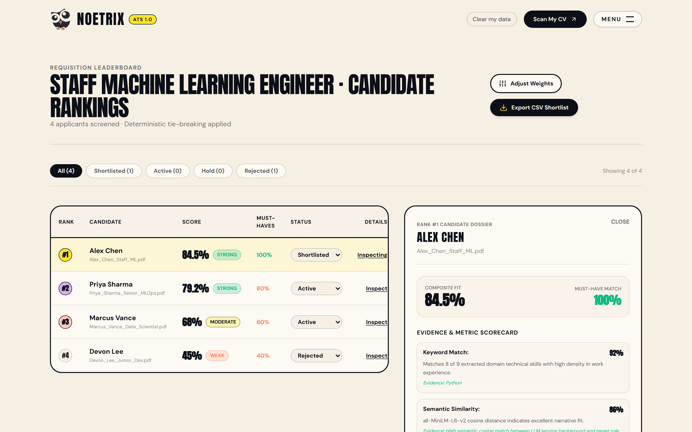

- **Evidence & Metric Scorecard**: Deep-dive rationale and direct text snippets for all 6 dimensions.
  - *Keyword Match (97.1%)*: Matched `python` in experience bullets.
  - *Semantic Fit (100%)*: Contextual similarity cosine score 0.785.
  - *Experience (100%)*: 6.8 years verified tenure vs 5.0 years required.
- **Audit Risk Flags**: Highlights potential formatting issues, gap anomalies, or missing credentials.
- **Requisition Status Management**: Single-click status toggle between `Shortlisted`, `Hold`, and `Rejected`.
- **CSV Export**: One-click RFC 4180 export for talent acquisition systems.

---

## 4. Summary of 6 Deterministic Evaluation Dimensions

| Dimension | Default Weight | Algorithmic Technique | Key Feature |
| :--- | :---: | :--- | :--- |
| **Hard-Skill Keywords** | **30%** | Regex word boundaries & taxonomy graph | Placement-weighted (Experience 1.0x, Skills 0.8x) |
| **Semantic Fit** | **20%** | MiniLM-L6-v2 dense embeddings (384-dim) | Contextual similarity clamp: `(cos - 0.15) / 0.50` |
| **Experience Tenure** | **20%** | Date extraction & 63-action-verb dictionary | Tenure ratio capped at 1.0 + action verb density |
| **Education & Degrees** | **10%** | Degree hierarchy classification | Prestige-free; eliminates institutional bias |
| **Impact & Metrics** | **10%** | Strict 10-pattern regex matching | Scored on measurable achievements (`%`, `$`, `RPS`, etc.) |
| **Format & ATS Health** | **10%** | Column gutter geometry & section detector | Single-column verification & entity extraction |

---
*Generated by Noetrix Automated Simulation & Test Suite.*
